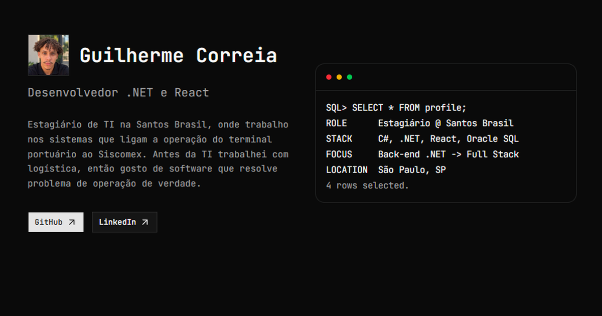

# guilhermecorreiafh.github.io

Meu portfólio pessoal: **[guilhermecorreiafh.github.io](https://guilhermecorreiafh.github.io)**



Como eu passo boa parte do dia no Oracle, o site tem cara de terminal SQL: abre com um `SELECT * FROM profile;` e termina com um `COMMIT; EXIT;`. No meio ficam os projetos, a experiência, as certificações e as tecnologias que uso no dia a dia.

## Tecnologias

- React com TypeScript, Vite
- Tailwind CSS e shadcn/ui
- Terminal animado do Magic UI
- Ícones das tecnologias pelo Devicon
- Deploy automático no GitHub Pages com GitHub Actions

## Rodando localmente

```bash
npm install
npm run dev
```

Abre em http://localhost:5173.

## Como está organizado

```
src/
  data.ts          textos do site: projetos, experiência, certificações e stack
  components/      uma seção por arquivo (Hero, Projects, Experience...)
public/
  projetos/        imagens dos projetos
  certificados/    PDFs das certificações
  logos/           logos da experiência
```

Todo o conteúdo fica no `data.ts`. Pra adicionar um projeto ou uma certificação nova, é só acrescentar um item na lista, sem mexer nos componentes.

## Deploy

Cada push na `main` gera o build e publica no GitHub Pages pelo workflow em `.github/workflows/deploy.yml`.
